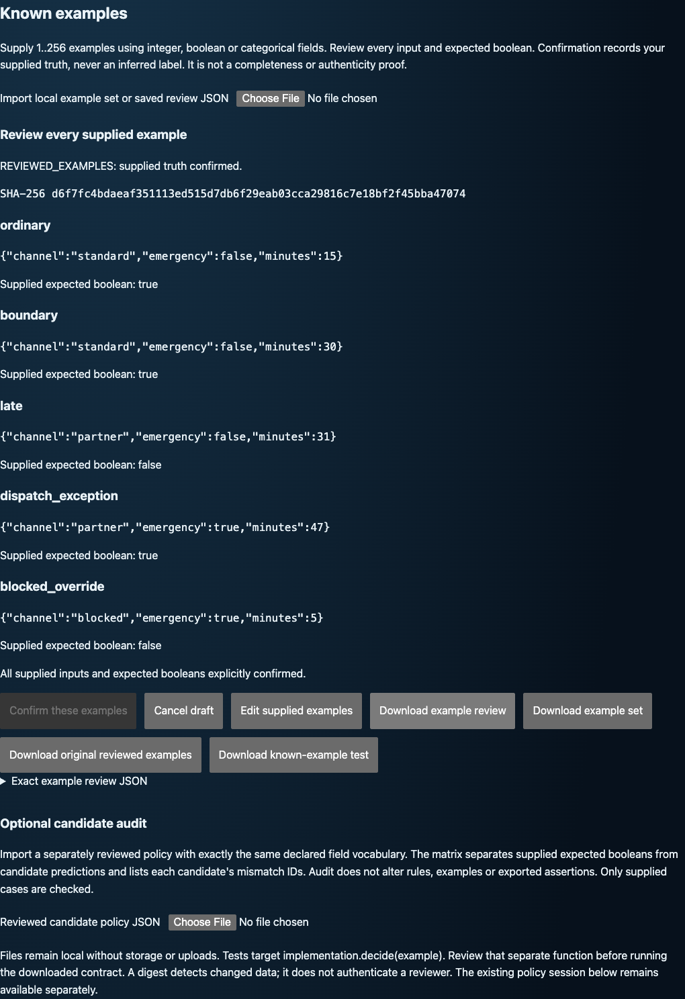

# Executable Clarifications

**“Within 30 days” is prose. What should happen on day 30 is a test.**

Review concrete inputs, record intended boolean outputs, and export those decisions as regression tests for a separate implementation. Start with known examples, or compare reviewed candidate policies to expose a boundary or exception worth deciding.

Python 3.11+ · Local CLI and browser workspace · No runtime dependencies, model provider or automatic code execution

The screenshot's table is synthetic. **Your explicit labels supply expected behavior. Candidate agreement does not supply truth.**

| What you have | What you get |
| --- | --- |
| Inputs with known intended outputs | A confirmed review record and tests for your own implementation |
| Several plausible bounded rules | Concrete inputs on which their behavior differs |
| A proposed policy edit | A finite behavioral comparison, including previously unlabelled witnesses |
| Confirmed examples that no offered rule satisfies | A deletion-minimal conflict explanation with checkable witnesses |

A direct `unittest` table is simpler when you only need assertions from already known cases. This project adds the review/session/revision workflow; it does not yet establish a human-productivity advantage.

## Try the supplied examples

From a source archive, with [uv](https://docs.astral.sh/uv/) installed:

~~~sh
uv venv .venv
uv pip install --python .venv/bin/python .
.venv/bin/executable-clarifications --version
mkdir -p .release-scratch/quickstart
.venv/bin/executable-clarifications \
  --examples tests/fixtures/known_examples.json --confirm-examples \
  --save-session .release-scratch/quickstart/review.json \
  --target implementation:decide \
  --export-test .release-scratch/quickstart/test_known.py
~~~

Expected: version `1.2.0`, then JSON with status `REVIEWED_EXAMPLES`, five `observed_examples` and execution marked **NOT RUN**. The review stores exact inputs, supplied booleans and a digest. The exported file calls your separately reviewed `implementation.decide(example)` and requires an exact boolean result.

The CLI neither imports nor runs that target. Review it before executing the export: **Python imports execute code; exported tests are not a sandbox.**

Resume without repeating confirmation:

~~~sh
.venv/bin/executable-clarifications --resume .release-scratch/quickstart/review.json
~~~

Read-only resume preserves the record. Output names must be new and distinct. Repeating the writing command exits 2 and preserves existing files.

## Review in the browser

The source archive/sdist contains the UI; the wheel provides the CLI and Python API.

~~~sh
.venv/bin/python scripts/serve_session_demo.py --port 8000
~~~

Open `http://127.0.0.1:8000/session.html`. The launcher verifies generated assets, binds literal loopback and stops with Ctrl-C.

**Known examples:** choose **Try five supplied examples**, inspect every row and confirm. **Start from known examples** supports integer, boolean and categorical fields and imported example sets. Editing an input or expected value disables assertion export until a fresh confirmation. Set **Known-example test target (module:function)** to your reviewed function, for example `billing.policy:eligible`. It defaults to `implementation:decide` in each new or reloaded tab. The target affects only this test export, stays out of saved review JSON, and never changes labels, digests or confirmation. Invalid targets block export; draft edits still require confirmation. [Target grammar](docs/USAGE.md#known-example-sets).

**Candidate rules:** choose **Build or edit a policy with forms**. Define typed fields, AND/OR predicates and concrete cases, or import [the refund policy](src/executable_clarifications/resources/refund_policy.json). Questions disclose differing rules. **Label true/false** records an explicit intended output even when all candidates disagree. **Neither** blocks assertion export. Undo restores the prior answer or label.

Download the session or example-review JSON to retain it. Import it to continue. The three supplied integer examples resume in the browser; other integer grids resume through the CLI. Invalid imports leave the current review unchanged.

### Deliberate saving, not invisible persistence

Unsaved answers and focused draft edits trigger a leave/reload warning. Reset and replacement ask before discarding work. Saving one review does not save another review or an unfinished draft. There is no automatic browser storage: warnings cannot recover a crashed tab. Retain the downloaded records.

## Review a policy change

After editing a policy, choose **Review this policy**. The preview preserves the original session and compares aligned candidate IDs on a disclosed finite grid. It reports directional changes and unlabelled witnesses, including changes that the recorded examples miss.

Start the revision without inherited answers. Unchanged inputs may be explicitly reconfirmed; changed inputs require fresh answers. Download both sessions before leaving; preview state is temporary.

~~~sh
.venv/bin/executable-clarifications \
  --policy examples/access-baseline.json \
  --compare-policy examples/access-proposed.json
~~~

Expected: 48 finite inputs, 14 false-to-true and two true-to-false changes for `access`. The two ordinary supplied examples miss both edits. This establishes neither intended outputs nor universal equivalence.

**Suggest boundary and exception cases** proposes unlabelled inputs and discloses domains, omitted combinations and limits. Applying suggestions uses the same empty-revision and explicit-review workflow. Finite completeness covers the reported values, not all integers or human intent.

## When no candidate fits, explain the gap

The CLI can isolate a small set of confirmed examples that collectively rules out every offered candidate. Use your own schema-compatible files:

~~~sh
.venv/bin/executable-clarifications \
  --examples your-examples.json --confirm-examples \
  --audit-policy your-candidates.json --explain-conflict
~~~

The report includes `core_example_ids`, one mismatched core example per eliminated candidate, and a fitting-candidate witness after each core example is removed. With rules “x equals 1” and “x equals 2”, the two labels `x=1 → false` and `x=2 → false` jointly eliminate both; an unrelated `x=3 → false` can be omitted from that explanation.

**Deletion-minimal is not minimum-cardinality.** The result does not say the labels are wrong, that intent is ambiguous, or that a correct rule is among the offered candidates. If a candidate fits, the tool reports that instead of manufacturing a conflict. In the browser, confirm known examples, import the separately reviewed candidate policy under Optional candidate audit, inspect the matrix and exact policy, then confirm that separate review and choose **Explain candidate gap**. The report includes concrete examples and checkable witnesses; edits, imports or changed candidate review hide it until reviewed again. Download it separately from the unchanged saved example review. [Conflict tests](tests/test_conflict_explanation.py).

## Review the guarantees, not a badge

| Promise | Adversarial check | Boundary |
| --- | --- | --- |
| No assertions before explicit example review | Existing confirmation, edit and “neither” controls | Digests do not authenticate a reviewer |
| Export targets an implementation, not its own demonstration | Wrong/non-boolean/missing target fixtures | Executing the exported test executes the target's Python |
| A candidate-gap explanation is inspectable | Removal and elimination witnesses; enumerated small labelings | The candidate set may be incomplete |
| CLI exports start private and roll back catchable failures | [Export faults](tests/test_export_integrity.py), [nested cleanup errors](tests/test_descriptor_cleanup.py) | No crash-atomic multi-file transaction or hostile-directory guarantee |

Browser downloads follow browser/OS permissions, not the CLI's POSIX mode. Do not present the CLI permission checks as browser-download protection. [Validation checks and limits](docs/VALIDATION.md).

## Stable V1 contracts

The CLI supports known examples, integer sessions and typed policies. Artifact schemas are versioned independently of the package; existing 0.7.0 formats remain readable without silent relabelling or migration. [Stability](docs/STABILITY.md) names the supported interfaces. Version 1.2.0 adds an explicit browser target for known-example test exports. The separate conflict-explanation report and existing saved-review meanings remain unchanged. See the [changelog](CHANGELOG.md).

[Usage and exact limits](docs/USAGE.md) covers APIs, schemas, explicit labels, candidate audits and integer grids. Only fixed integer comparisons and bounded typed predicates are supported. There is no prose-to-policy inference, provider generation or supplied-code execution.

## Verify

Node is required for parity tests. Optional development tools have exact pins:

~~~sh
uv pip install --python .venv/bin/python -r requirements-release.txt -r requirements-lint.txt
.venv/bin/ruff check --no-cache src scripts tests
uv run --no-project --python .venv/bin/python python scripts/verify_release.py --browser
~~~

Set `CHROMIUM_PATH` to an existing trusted Chromium executable. [Evaluation](docs/EVALUATION.md) documents isolated wheel/fresh-sdist verification and seven HTTP browser suites. Tests or workflows being present does not establish that this revision passed them.

## Boundaries and support

Only recorded examples become assertions. Candidate agreement can miss an unasked input. Files stay local without uploads, telemetry or browser storage. The unauthenticated local server must remain on loopback. See [security](SECURITY.md).

Human usefulness/comprehension, independent human intent labels, productivity, screen-reader studies and live-model evaluations remain **NOT RUN**. [ClarifyGPT](https://doi.org/10.1145/3660810) is a primary predecessor; this is a scoped implementation, not a replication or superiority result.

Use repository issues for minimal synthetic reproducers without private data. Use an established private maintainer channel for security issues.

[Design](docs/DESIGN.md) · [Limitations](docs/LIMITATIONS.md) · [References](docs/REFERENCES.md) · [Contributing](CONTRIBUTING.md) · [MIT license](LICENSE)

Personal R&D by Jason Lovell. No employer/client endorsement is implied. Third-party development tools retain their own terms.
